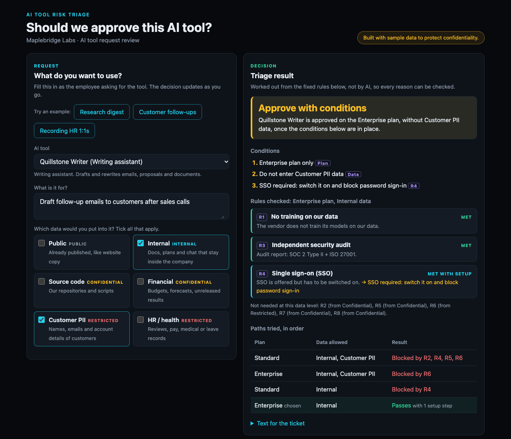

# AI Tool Risk Triage

> Built with sample data to protect confidentiality. "Maplebridge Labs" and every vendor in this project are fictional. Vendor answers are sample values, not real vendors' policies.

## Problem
Employees keep finding new AI tools and asking IT to approve them. Each request raises the same questions: will the vendor train on our data, how long does it keep it, can we control who signs in? Without a standard check, answers depend on who reviews the ticket, and nobody can explain afterwards why one tool was approved and another wasn't.

This tool answers **"should we approve this AI tool at all?"** It is the "before" half of a pair with [AI Value Tracker](https://github.com/sr-tech-hub/ai-value-tracker), which answers "is our AI spend paying off?" once tools are bought. Approve first, then measure.

## What it checks
The employee picks a tool (or enters one that isn't listed), says what it's for, and ticks the data they'd put into it. The most sensitive data ticked sets the **data level**: Public, Internal, Confidential (source code, financial) or Restricted (customer PII, HR/health). Higher levels check more rules:

| Rule | Checked from | If not met |
| --- | --- | --- |
| R1 No training on our data | Internal | Blocks |
| R2 Data retention of 30 days or less | Confidential | Blocks |
| R3 Independent security audit (SOC 2 Type II or ISO 27001) | Internal | Blocks |
| R4 Single sign-on (SSO) | Internal | Blocks |
| R5 Data processing agreement (DPA) | Confidential | Blocks |
| R6 Data stays in the US/EU | Restricted | Blocks |
| R7 Automatic account removal (SCIM) | Confidential | Workaround: IT removes leavers by hand |
| R8 Admin audit logs | Confidential | Workaround: manager reviews use quarterly |

Each rule's starting level, whether it blocks, and the retention limit are editable on the page, and every decision updates live.

The page tries the Standard plan, then the Enterprise plan, with all the requested data. If both are blocked it tries again without the most sensitive data, as long as some requested data is left. The first plan with nothing blocking it wins, and the result is one of:

- **Approve:** the Standard plan passes for everything requested, with no conditions.
- **Approve with conditions:** a plan passes, but only on Enterprise, without some data, or after setup steps. Each condition is listed.
- **Deny:** nothing passes. The blocking rules are listed so the requester knows what would have to change.

Every reason shows the rule that produced it (R1–R8), and a "Paths tried" table shows each plan and data combination checked. A "Text for the ticket" box gives a copyable summary.

## Example results
The three example buttons on the page give one of each decision:

1. **Research digest: Approve.** Ferngrove Research, to summarise analyst reports and industry news, with Public and Internal data. Internal level, so R1, R3 and R4 are checked; all are met on the Standard plan.
2. **Customer follow-ups: Approve with conditions.** Quillstone Writer, to draft follow-up emails to customers, with Internal data and Customer PII. Both plans are blocked for PII by R6 (the vendor doesn't guarantee where data is stored), and the Standard plan has no SSO. Result: **Enterprise plan only; do not enter Customer PII; SSO required (switch it on and block password sign-in).**
3. **Recording HR 1:1s: Deny.** Lumen Notes, to record and summarise manager 1:1 meetings, with Internal and HR/health data. It fails R1 to R6 at the Restricted level, and still fails R1, R3 and R4 with HR data removed: it trains on customer data with no opt-out, has no security audit and no SSO.

Other sample vendors show the in-between cases. Codewright, with source code, passes the Standard plan with five setup steps and the page notes that its Enterprise plan would need none. Pixelmint Studio is approved for public data only and denied as soon as internal data is ticked.

## How it works
1. `data/vendors.json` holds six fictional vendors, each with sample answers to the eight questions for a Standard plan and, for some, an Enterprise plan.
2. The scoring rules are a short, plain config at the top of the script in `index.html`. Each rule names the vendor answer it reads, the data level it starts at, and whether it blocks.
3. One function, `triage()`, makes every decision: it tries each plan and data level in a fixed order and returns the first that passes, with everything it tried. The decision, the reasons, the paths table and the ticket text all come from its result, so they can't disagree.
4. Decisions come from fixed rules, not AI, so a manager can read exactly why a tool was approved or denied.
5. "Unknown" counts as not met. If a vendor can't confirm something, the tool doesn't assume it.

## How to run it
1. Open the live demo (link below), or download/clone this repository.
2. To run it locally, start a small web server in the project folder with `python3 -m http.server`, then open http://localhost:8000. If you double-click `index.html` instead, the browser blocks it from reading the vendor list; the page still works with "Other" and vendor answers filled in by hand.

Live demo: https://sr-tech-hub.github.io/ai-tool-risk-triage/

## Built with
HTML, CSS and JavaScript (single page, no build step, no libraries), developed with Claude Code.
